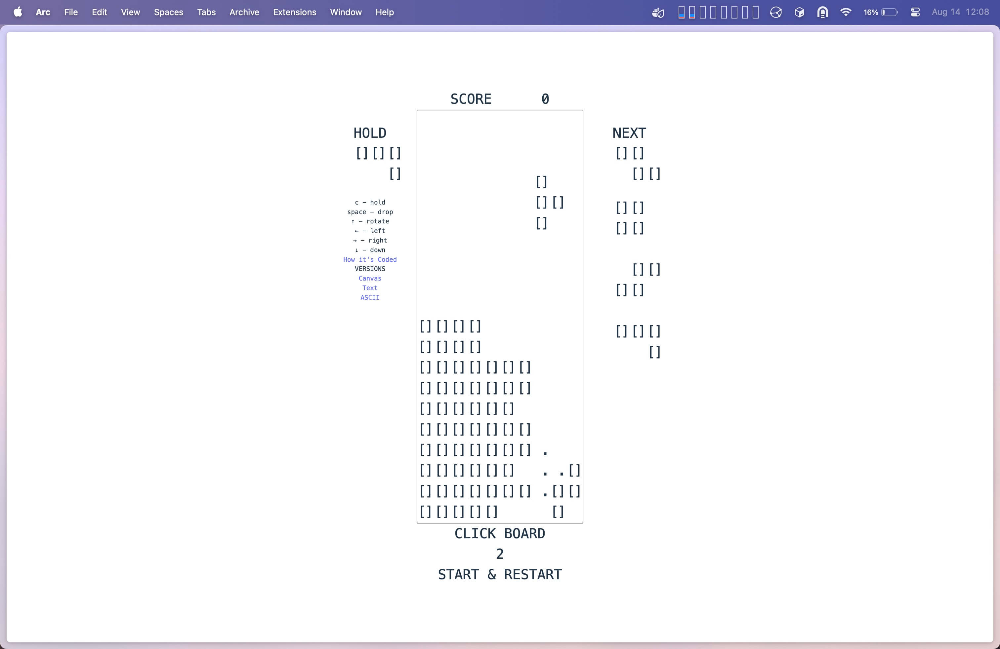

I've first made tetris using [`<canvas>`](/tech/?slug=2025-08-07--I%27ve-Built-Tetris-Using-ReactJS)
then also in [Unicode](/tech/?slug=2025-08-11--I%27ve-Built-Tetris-Using-Unicode) (i.e. 🟧🟪🟥🟦🟨🟩).

So late at night, I've decided to make tetris again using ASCII characters.

[git.marcuschiu.com/tetris-ascii](https://git.marcuschiu.com/tetris-ascii)

