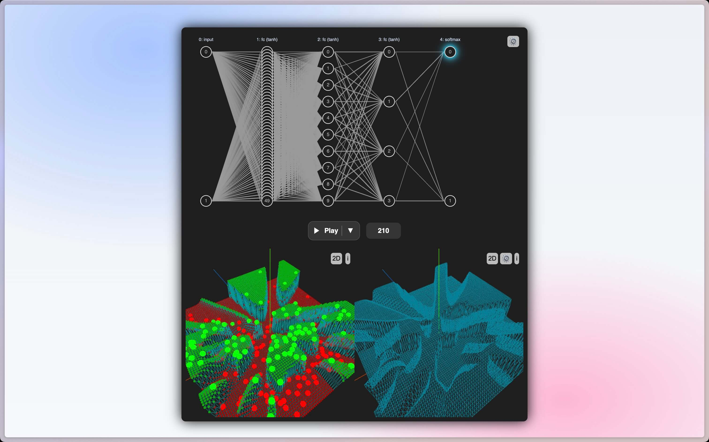

# Problem

I've always wanted to create an interactive tool to visualize what's happening within a neural network.

# Solution

And so I did:

- [git.marcuschiu.com/visualizing-neural-networks](https://git.marcuschiu.com/visualizing-neural-networks/)

